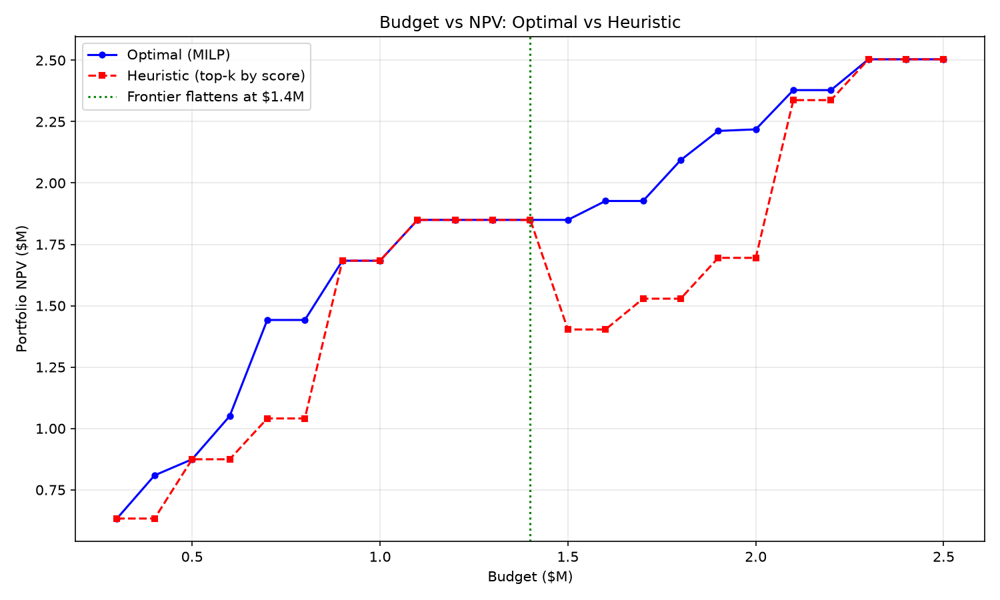
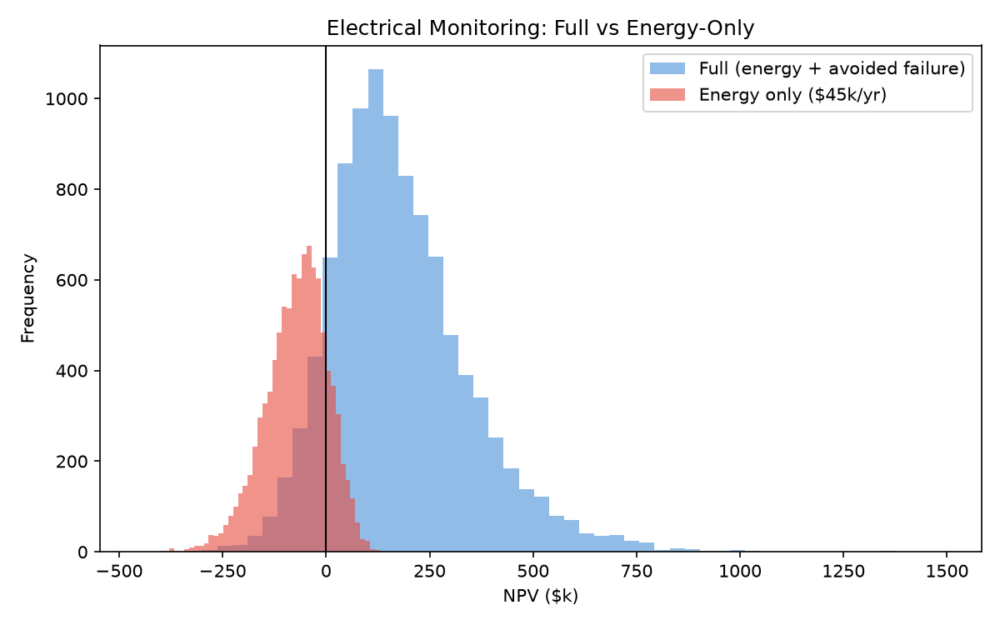
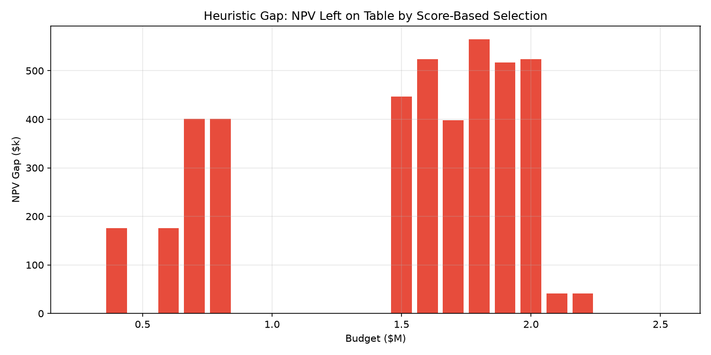
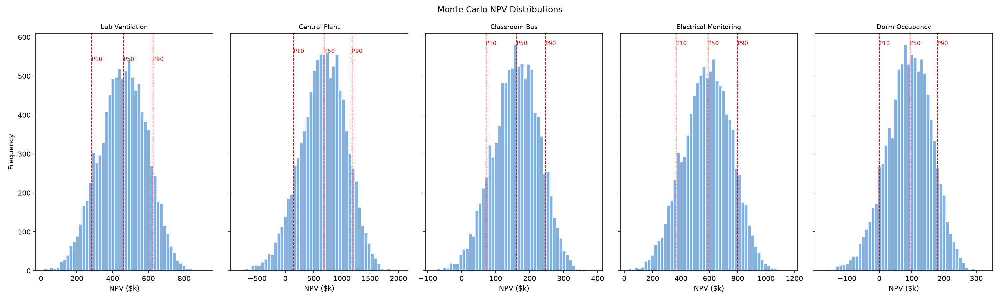
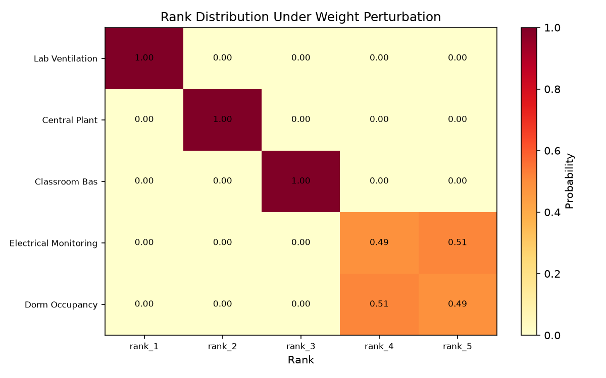
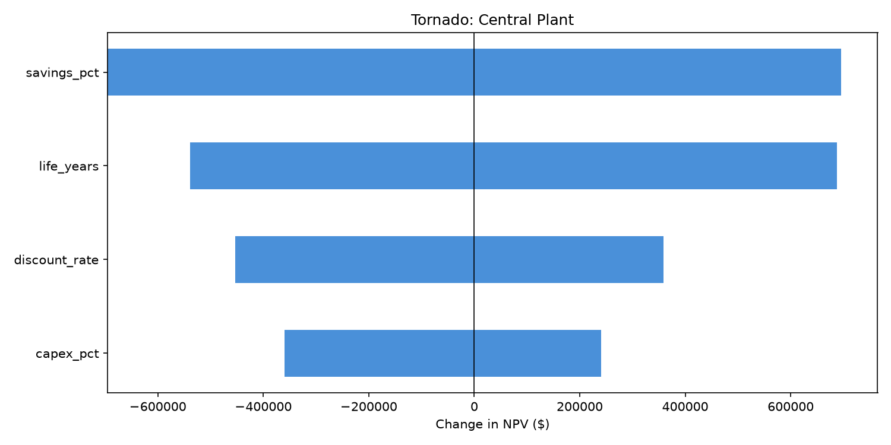
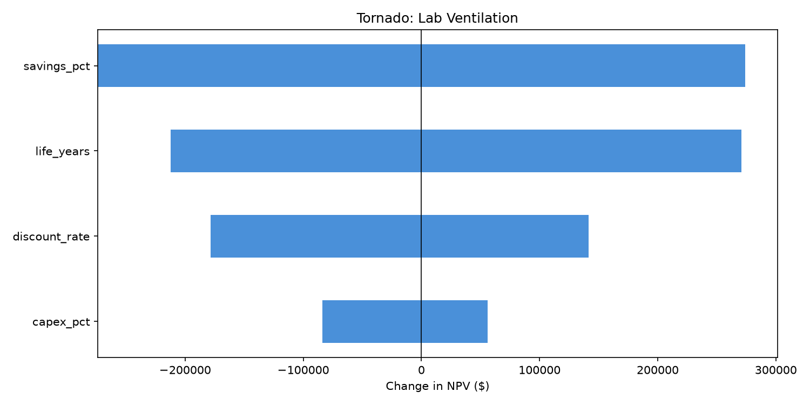

# CMPM Validation Harness — Report

**Generated by automated adversarial testing pipeline.**

All synthetic data is labeled. All assumptions from config.yaml.


## 1. Replication Table (Claimed vs Computed)

| Project | Claimed NPV | Computed NPV | Delta | PASS | Claimed Payback | Computed Payback | PASS | Claimed IRR | Computed IRR | PASS |
|---------|------------|-------------|-------|------|----------------|-----------------|------|------------|-------------|------|
| lab_ventilation | $633,000 | $633,066 | $66 | PASS | 2.15 | 2.15 | PASS | 45.0% | 45.3% | PASS |
| central_plant | $1,118,000 | $1,117,782 | $-218 | PASS | 3.64 | 3.64 | PASS | 24.0% | 24.4% | PASS |
| classroom_bas | $241,000 | $241,415 | $415 | PASS | 3.00 | 3.00 | PASS | 31.0% | 31.1% | PASS |
| electrical_monitoring | $809,000 | $808,891 | $-109 | PASS | 2.12 | 2.12 | PASS | 46.0% | 46.1% | PASS |
| dorm_occupancy | $166,000 | $166,297 | $297 | PASS | 4.00 | 4.00 | PASS | 21.0% | 21.4% | PASS |

## 2. Findings Ranked by Severity

- **[CRITICAL]** Projects with NPV < 0 under joint downside (central_plant, classroom_bas, dorm_occupancy). These do not survive adversarial testing.
- **[CRITICAL]** Electrical monitoring without avoided-failure term: P(NPV>0) = 16.6%. The entire case rests on speculative failure avoidance.
- **[HIGH]** Full portfolio naive NPV overstates by $463,556 (15.6%) due to savings interactions.
- **[HIGH]** Score ranking vs profitability index: Kendall tau = 0.00. The scoring system and economic optimization disagree substantially.
- **[HIGH]** Maximum NPV left on table by score-based heuristic: $564,264. MILP optimization outperforms naive score-based selection.
- **[INFO]** Projects surviving joint downside: lab_ventilation, electrical_monitoring
- **[MEDIUM]** Projects with unstable top-2 ranking under weight perturbation: classroom_bas, electrical_monitoring, dorm_occupancy
- **[MEDIUM]** Weight double-counting via correlation: financial (VIF=1.96), recoverable_inefficiency (VIF=1.73)
- **[INFO]** Waste detection: change-point bias = -0.016, GB bias = -0.026. Both struggle to detect the 12% injected waste.

## 3. Claims That Survive Adversarial Testing

| Claim | Survives? | Evidence |
|-------|----------|---------|
| lab_ventilation is NPV-positive | Yes | Joint downside NPV = $98,530, MC P(NPV>0) = 100.0% |
| central_plant is NPV-positive | **No** | Joint downside NPV = $-385,885, MC P(NPV>0) = 94.7% |
| classroom_bas is NPV-positive | **No** | Joint downside NPV = $-20,525, MC P(NPV>0) = 98.9% |
| electrical_monitoring is NPV-positive | Yes | Joint downside NPV = $132,058, MC P(NPV>0) = 100.0% |
| dorm_occupancy is NPV-positive | **No** | Joint downside NPV = $-90,314, MC P(NPV>0) = 90.0% |

## 4. Configuration (config.yaml)

```yaml
# =============================================================================
# CMPM Validation Harness — Configuration
# ALL assumptions live here. Nothing is hardcoded in the Python modules.
# Values tagged ARBITRARY are placeholders chosen for illustration;
# replace them with defensible estimates before using for real decisions.
# =============================================================================

general:
  discount_rate: 0.07
  analysis_life_years: 10
  random_seed: 42
  monte_carlo_draws: 10000

projects:
  lab_ventilation:
    name: "Lab ventilation + controls"
    capex: 280000
    annual_benefit: 130000
    strategic_score: 89
    sub_scores:
      financial: 95
      recoverable_inefficiency: 92
      implementation_feasibility: 80
      operational_importance: 88
      sustainability: 78
  central_plant:
    name: "Central plant optimization"
    capex: 1200000
    annual_benefit: 330000
    strategic_score: 84
    sub_scores:
      financial: 78
      recoverable_inefficiency: 90
      implementation_feasibility: 72
      operational_importance: 95
      sustainability: 82
  classroom_bas:
    name: "Classroom BAS/scheduling"
    capex: 180000
    annual_benefit: 60000
    strategic_score: 75
    sub_scores:
      financial: 70
      recoverable_inefficiency: 74
      implementation_feasibility: 88
      operational_importance: 70
      sustainability: 72
  electrical_monitoring:
    name: "Electrical predictive monitoring"
    capex: 350000
    annual_benefit: 165000          # hypothetical: avoided-failure + maintenance, NOT energy
    strategic_score: 66
    sub_scores:
      financial: 72
      recoverable_inefficiency: 55
      implementation_feasibility: 70
      operational_importance: 65
      sustainability: 60
  dorm_occupancy:
    name: "Dorm occupancy controls"
    capex: 220000
    annual_benefit: 55000
    strategic_score: 65
    sub_scores:
      financial: 62
      recoverable_inefficiency: 68
      implementation_feasibility: 82
      operational_importance: 55
      sustainability: 60

score_weights:
  financial: 0.30
  recoverable_inefficiency: 0.25
  implementation_feasibility: 0.15
  operational_importance: 0.20
  sustainability: 0.10

# Real-world frictions — all default OFF (0) for baseline replication
frictions:
  energy_escalation_rate: 0.02      # ARBITRARY: 2%/yr energy price increase
  savings_decay_rate: 0.03          # ARBITRARY: 3%/yr savings degradation
  residual_value_pct: 0.10          # ARBITRARY: 10% of capex residual at end of life
  om_cost_annual_pct: 0.02          # ARBITRARY: 2% of capex per year for O&M

# Sensitivity analysis (Step 2)
sensitivity:
  tornado_ranges:
    savings_pct: [-0.30, 0.30]      # -30% to +30% of base
    capex_pct: [-0.20, 0.30]        # -20% to +30% of base
    discount_rate: [0.04, 0.12]     # absolute range
    life_years: [7, 15]             # absolute range
  joint_downside:
    savings_multiplier: 0.70        # -30%
    capex_multiplier: 1.30          # +30%
    delay_years: 1
    savings_decay_rate: 0.03        # 3%/yr
    life_years: 8
  lab_sensitivity:
    savings_pct_range: [-0.20, 0.20]
    discount_rates: [0.04, 0.10]
    capex_increase_pct: 0.20

# Monte Carlo distributions (Step 3)
monte_carlo:
  savings_triangular: [0.60, 1.00, 1.15]   # (low, mode, high) multiplier
  capex_lognormal_sigma: 0.20               # right-skewed overruns
  delay_distribution:                        # discrete years: probability
    0: 0.60
    1: 0.30
    2: 0.10
  discount_triangular: [0.05, 0.07, 0.10]  # (low, mode, high) absolute
  decay_uniform: [0.00, 0.04]              # uniform savings decay per year
  correlation_rho: -0.20                    # ARBITRARY: savings-capex correlation

# Electrical project specifics (Step 3)
electrical_project:
  failure_probability: 0.08               # ARBITRARY: annual prob of major failure
  failure_probability_beta_alpha: 4.0     # ARBITRARY: beta shape for p_fail
  failure_probability_beta_beta: 46.0     # ARBITRARY: gives mean ~0.08
  failure_consequence: 500000             # ARBITRARY: cost if failure occurs ($)
  failure_consequence_log_sigma: 0.30     # ARBITRARY: lognormal spread
  energy_only_benefit: 45000              # energy-savings-only component ($/yr)

# Project interactions (Step 4)
interactions:
  # (source, target): fraction by which source reduces target's savings
  lab_ventilation__central_plant: 0.15    # lab ventilation reduces plant savings by 15%
  classroom_bas__central_plant: 0.05      # classroom scheduling reduces plant savings by 5%

# Optimization (Step 5)
optimization:
  budget_sweep:
    min: 300000
    max: 2500000
    step: 100000
  dependency:
    # project A requires project B to be selected
    classroom_bas: central_plant
  mutual_exclusion:
    # at most one of these can be selected
    - [dorm_occupancy, classroom_bas]     # ARBITRARY: example constraint
  multi_year:
    num_periods: 3
    budgets: [1000000, 800000, 700000]    # ARBITRARY: per-period budget

# Scoring analysis (Step 6)
scoring:
  dirichlet_concentration: 50             # ARBITRARY: higher = tighter around baseline
  weight_draws: 10000
  synthetic_population_30: 30             # for normalization sensitivity
  synthetic_population_200: 200           # for correlation double-counting
  normalization_seed: 123                 # ARBITRARY

# Baseline model sanity check (Step 7)
baseline:
  injected_waste_fraction: 0.12           # 12% simultaneous heating/cooling
  base_load_kw: 500                       # ARBITRARY: base electrical load (kW)
  heating_slope: 15.0                     # ARBITRARY: kW per heating degree
  cooling_slope: 12.0                     # ARBITRARY: kW per cooling degree
  heating_changepoint_f: 55.0             # ARBITRARY: heating balance point (°F)
  cooling_changepoint_f: 65.0             # ARBITRARY: cooling balance point (°F)
  noise_std_kw: 30.0                      # ARBITRARY: random noise std dev
  occupancy_multiplier: 1.25              # ARBITRARY: occupied vs unoccupied
  gb_n_estimators: 200                    # ARBITRARY
  gb_max_depth: 5                         # ARBITRARY
  gb_learning_rate: 0.05                  # ARBITRARY
  rolling_origin_min_train_days: 180      # minimum training window
  rolling_origin_step_days: 30            # step between folds

```


## 5. What a Skeptical Judge Would Ask

**Q: How sensitive is the ranking to the discount rate?**

A: lab_ventilation: NPV ranges from $454,529 (12%) to $774,416 (4%); central_plant: NPV ranges from $664,574 (12%) to $1,476,596 (4%); classroom_bas: NPV ranges from $159,013 (12%) to $306,654 (4%); electrical_monitoring: NPV ranges from $582,287 (12%) to $988,298 (4%); dorm_occupancy: NPV ranges from $90,762 (12%) to $226,099 (4%).

**Q: What if savings are 30% lower than projected?**

A: lab_ventilation: NPV = $359,146; central_plant: NPV = $422,447; classroom_bas: NPV = $114,990; electrical_monitoring: NPV = $461,224; dorm_occupancy: NPV = $50,408.

**Q: Are the savings estimates additive?**

A: No. With all projects selected, interaction effects reduce portfolio NPV by $463,556 (15.6%).

**Q: What is the probability each project has positive NPV?**

A: lab_ventilation: P(NPV>0) = 100.0%; central_plant: P(NPV>0) = 94.7%; classroom_bas: P(NPV>0) = 98.9%; electrical_monitoring: P(NPV>0) = 100.0%; dorm_occupancy: P(NPV>0) = 90.0%.

**Q: Does the scoring system agree with economic analysis?**

A: Weakly. Kendall tau between composite score and profitability index = 0.00.

**Q: Can we detect the kind of waste this model targets?**

A: The synthetic test injected 12% waste. Change-point model estimated 1.1%, gradient boosting estimated 0.1%.

**Q: What is the worst-case 10% NPV for each project?**

A: lab_ventilation: ES10 = $222,091; central_plant: ES10 = $-62,451; classroom_bas: ES10 = $38,149; electrical_monitoring: ES10 = $288,569; dorm_occupancy: ES10 = $-36,675.


## Charts














